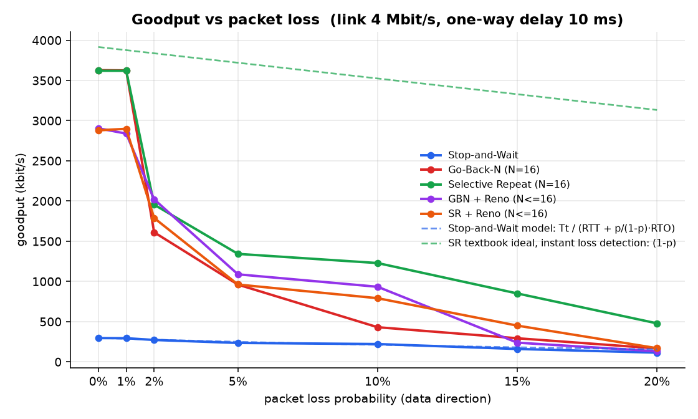
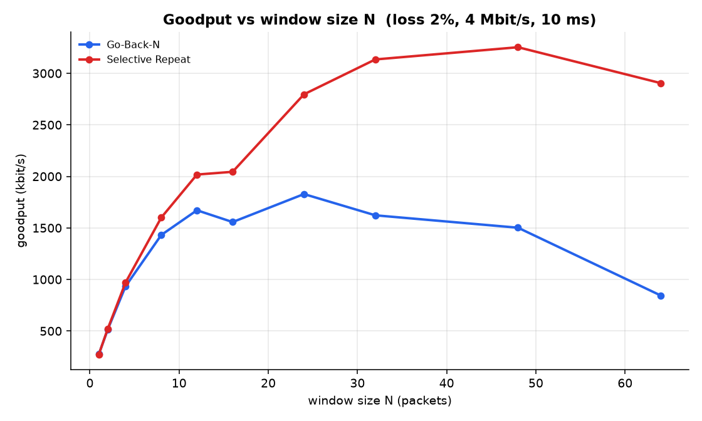
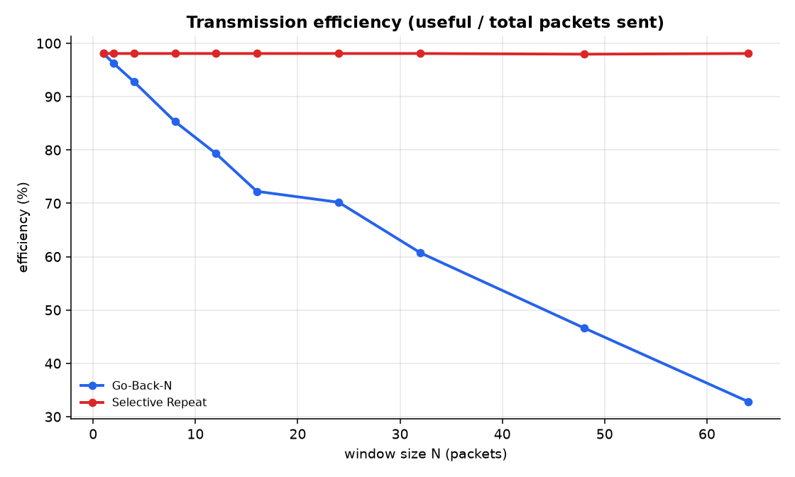
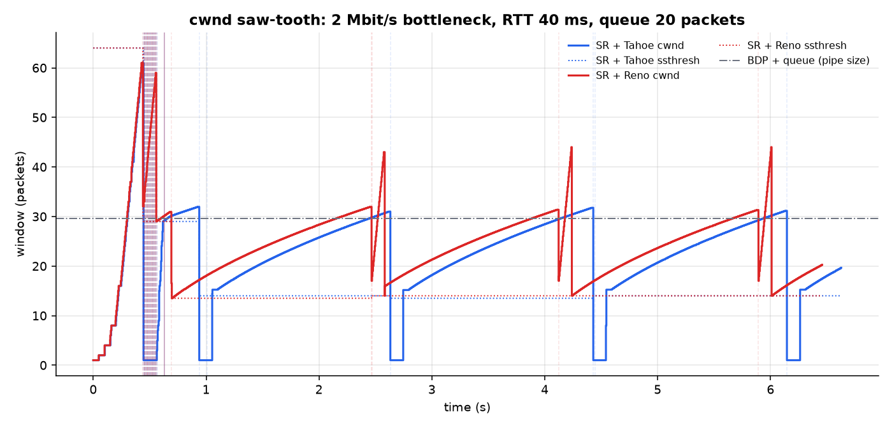
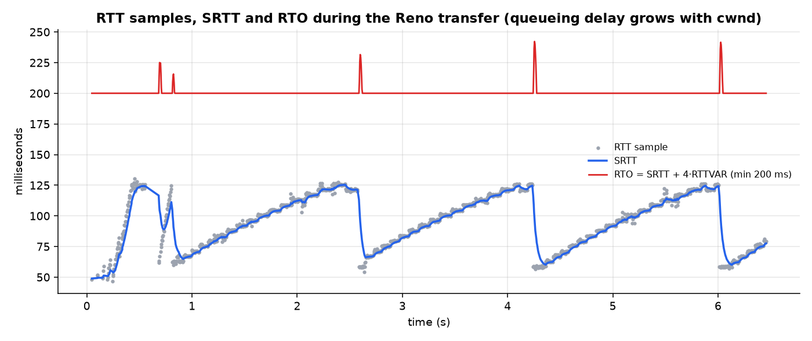
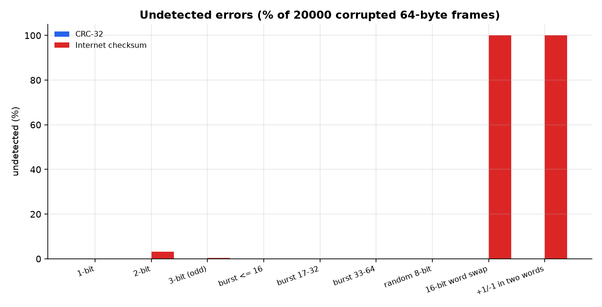
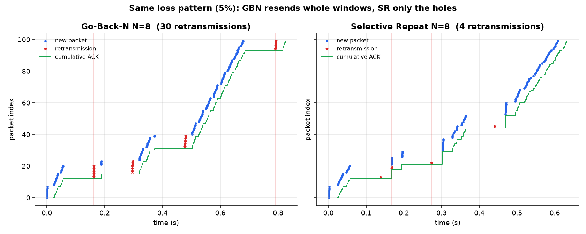

# RUDP: reliable file transfer over UDP

**DCCN mini project (CMP-302 Data Communications and Computer Networks, CMP-303 lab)**

> Presenting the project? Start with the short **[demo guide](DEMO.md)**.

UDP gives you no guarantees: packets can be lost, corrupted, duplicated or
arrive out of order. This project builds a **reliable, TCP-like transport
protocol on top of plain UDP sockets** and uses it to send files between two
computers. All the reliability comes from code written here, not from TCP:

| Layer / topic | Implemented in | What it does |
|---|---|---|
| Error detection | [rudp/checksum.py](rudp/checksum.py) | CRC-32 (table-driven and bit-by-bit), the Internet checksum (RFC 1071), and a CRC long-division calculator that prints the working |
| Framing | [rudp/packet.py](rudp/packet.py) | A 22-byte header (flags, sequence/ACK numbers, window, length, checksum) |
| ARQ: Stop-and-Wait | [rudp/sender.py](rudp/sender.py) | Alternating-bit protocol (1-bit sequence numbers) |
| ARQ: Go-Back-N | [rudp/sender.py](rudp/sender.py), [rudp/receiver.py](rudp/receiver.py) | Sliding window, cumulative ACKs, one timer |
| ARQ: Selective Repeat | [rudp/sender.py](rudp/sender.py), [rudp/receiver.py](rudp/receiver.py) | Per-packet timers, selective ACKs, receiver buffering |
| Sequence-number space | `--seq-bits m` | Window limits 2^m - 1 (GBN) and 2^(m-1) (SR), plus a demo of what breaks when they are exceeded |
| Flow control | receiver `window` field | The receiver advertises its free buffer space (rwnd) |
| Adaptive timeout | [rudp/rtt.py](rudp/rtt.py) | Jacobson/Karels SRTT/RTTVAR (RFC 6298), Karn's rule, exponential back-off |
| Congestion control | [rudp/congestion.py](rudp/congestion.py) | TCP Tahoe and Reno: slow start, congestion avoidance (AIMD), fast retransmit, fast recovery, SACK-based hole repair |
| Connection management | sender/receiver | 3-way handshake (SYN, SYN-ACK, ACK), FIN/FIN-ACK teardown, TIME_WAIT, RST |
| End-to-end integrity | FIN payload | SHA-256 of the whole file, checked by the receiver |
| An unreliable link | [rudp/channel.py](rudp/channel.py) | Emulated bandwidth, propagation delay, drop-tail queue, random and burst loss, bit errors, duplication, jitter/reordering |
| Measurement | [rudp/experiments.py](rudp/experiments.py) | Six experiments that produce CSVs, graphs and [results/REPORT.md](results/REPORT.md) |
| Live visualizer | [rudp/viz.py](rudp/viz.py), [rudp/web/viz.html](rudp/web/viz.html) | A browser page that animates a *real* transfer in slow motion: packets flying, losses, sliding windows, timers, cwnd |
| Router / middlebox | [rudp/router.py](rudp/router.py) | Relays datagrams between sender and receiver through an impaired link, like a congested router in the middle of the network |

The protocol code uses only the Python standard library. Matplotlib is only
needed for the graphs.

---

## Contents

1. [Quick start](#1-quick-start)
2. [Sending a file between two laptops](#2-sending-a-file-between-two-laptops)
   (and [through a router](#putting-the-bad-network-in-the-middle-router))
3. [Viva and demo script](#3-viva-and-demo-script)
   (and the [live visualizer](#live-visualizer))
4. [How it works](#4-how-it-works)
5. [Experiments and results](#5-experiments-and-results)
6. [Syllabus mapping](#6-syllabus-mapping)
7. [Command reference](#7-command-reference)
8. [Project layout and tests](#8-project-layout-and-tests)
9. [Viva questions and answers](#9-viva-questions-and-answers)
10. [Limitations and possible extensions](#10-limitations-and-possible-extensions)

---

## 1. Quick start

Requirements: Python 3.10 or newer.

```bash
pip install -r requirements.txt
```

Open the live visualizer in your browser and click a scenario. A real
transfer runs in slow motion while the page animates every packet:

```bash
python -m rudp viz
```

Or watch the same thing as a coloured log in the terminal: a Go-Back-N
transfer over a link that drops 15% of packets, with every send, loss,
timeout, ACK and delivery printed:

```bash
python -m rudp demo
```

The same demo with Selective Repeat, so you can compare:

```bash
python -m rudp demo --proto sr
```

Run the test suite (51 tests, about 30 s):

```bash
python -m pytest -q
```

Regenerate every graph and table in `results/` (about 10 minutes; `--quick` takes about 3):

```bash
python -m rudp bench
```

---

## 2. Sending a file between two laptops

Both laptops must be on the same network and both need this folder. College
Wi-Fi often blocks traffic between devices ("client isolation"). If the
transfer cannot connect, put both laptops on one phone's hotspot.

**Laptop B (receiver):**

```bash
python -m rudp recv --port 9000 --out received
```

It prints its own IP address and the exact command to run on the other laptop,
for example `python -m rudp send FILE --to 192.168.1.23:9000`.

**Laptop A (sender):**

```bash
python -m rudp send photo.jpg --to 192.168.1.23:9000 --proto sr --window 32 --cc reno
```

The sender shows a live progress bar (percentage, KB/s, retransmissions,
timeouts, cwnd and RTO). At the end both sides print a summary, and the
receiver confirms the SHA-256 hash matches.

A real LAN loses almost nothing, so to show the protocol recovering, add
impairments on the sender (and optionally on the receiver, which impairs the
ACKs):

```bash
python -m rudp send photo.jpg --to 192.168.1.23:9000 --proto gbn --window 16 --loss 0.1 --corrupt 0.02 --delay 30 --jitter 10
```

```bash
python -m rudp recv --port 9000 --loss 0.1 -v
```

**Firewalls:** the first time, macOS asks "Allow incoming connections?" for
Python. Click Allow. On Windows, allow Python through Windows Defender
Firewall on private networks. If nothing arrives, check that the port is the
same on both sides and try the hotspot.

Save the full trace and draw graphs from a real transfer:

```bash
python -m rudp send big.pdf --to 192.168.1.23:9000 --cc reno --json run.json
```

```bash
python -m rudp plot run.json
```

This writes `run_seq.png` (sequence number vs time), `run_rtt.png` (RTT, SRTT,
RTO) and `run_cwnd.png` (congestion window).

### Putting the bad network in the middle (router)

Instead of each end impairing its own packets, a third program can act as a
lossy router between them. It only relays UDP datagrams and knows nothing
about RUDP, so the protocol has to cope with whatever the router does. Use
three laptops, or three terminals on one machine:

```bash
python -m rudp recv --port 9001
```

```bash
python -m rudp router --port 9000 --to RECEIVER_IP:9001 --loss 0.08 --corrupt 0.02 --delay 15 --rate 6000 --queue 30 --ack-loss 0.05
```

```bash
python -m rudp send big.pdf --to ROUTER_IP:9000 --proto sr --window 32 --cc reno
```

The router prints how many packets it forwarded, lost, corrupted and dropped
from its queue every 5 seconds (`-v` logs every damaged frame). In testing,
a 500 KB file crossed this exact setup (8% loss, 2% bit errors, a 6 Mbit/s
bottleneck with a 30-packet queue, 5% ACK loss) and arrived byte-for-byte
identical.

---

## 3. Viva and demo script

### Live visualizer

```bash
python -m rudp viz
```

This opens `http://localhost:8765`. Pick a scenario, or set the protocol,
window, sequence bits, congestion control, losses, bit errors, duplicates,
delay and jitter yourself, then press **Run transfer**. The page is driven by
a real transfer: real sender and receiver code over real UDP sockets. The
link just gets a long delay (700 ms by default) so it can be followed by eye.

| On screen | Meaning |
|---|---|
| Top row of boxes | The sender's packets: grey = not sent, blue = waiting for ACK, green = ACKed. The blue frame is the **send window** [base, base+N), and it slides as ACKs arrive. |
| Bottom row of boxes | The receiver: green = delivered in order, purple = buffered out of order (SR), red = **stale data accepted** (unsafe window). The dashed frame is the **receive window**. |
| Small numbers above/below | The sequence number on the wire (index mod 2^m) when m < 32, so you can see the numbers wrap. |
| Blue / amber boxes flying down | DATA / retransmitted DATA. Orange means bit errors were injected. |
| Green circles flying up | ACKs, labelled with the ACK number. |
| Red ✗ | Lost on the link. |
| Bar under a sender box | Its retransmission timer filling up (green → amber → red). GBN shows one timer, SR one per packet. |
| ⏰ / ⚡3 dup / "discard" / "buffer" / "CRC ✗" / "STALE!" | Timeout, fast retransmit, GBN discard, SR buffering, CRC failure, stale data. |
| Chart | cwnd (solid) and ssthresh (dashed) when Tahoe/Reno is on. |
| Event log | Every event in words, e.g. "RECEIVER got seq 3: out of order (expecting 1) → DISCARD". |
| Banner | "File delivered intact" (SHA-256 verified) or "File CORRUPTED". |

The built-in scenarios are Stop-and-Wait, Go-Back-N, Selective Repeat (same
seed as Go-Back-N for a direct comparison), Lost ACKs, Bit errors (CRC),
Reordering, TCP Reno and Unsafe window. Each one shows a "what to watch"
note.

### Viva script

About 8 minutes; each step shows one syllabus topic. Steps 2-7 work either
in the visualizer (click the scenario) or in the terminal (`demo` command).

| # | Command | What to point out |
|---|---|---|
| 1 | `python -m rudp crc 1101011011 10011` | CRC long division exactly as on paper. Remainder `1110`, transmitted frame `11010110111110`. |
| 2 | `python -m rudp demo --proto sw --packets 6 --loss 0.3` | Stop-and-Wait: sequence numbers alternate 0,1,0,1. Each loss costs one full timeout. |
| 3 | `python -m rudp demo --proto gbn --window 4` | Go-Back-N: one packet lost, the receiver *discards* the following ones, the timer expires and the sender "goes back" and resends the whole window. |
| 4 | `python -m rudp demo --proto sr --window 4` | Same link seed as step 3. Selective Repeat: the receiver *buffers* out-of-order packets and only the lost ones are resent. |
| 5 | `python -m rudp demo --proto sr --packets 10 --corrupt 0.3 --loss 0` | Bit errors on the link. The receiver logs `BADCRC ... dropped`, and the timeout recovers. |
| 6 | `python -m rudp demo --proto sr --cc reno --window 16 --packets 60 --loss 0.05` | Slow start (cwnd 1, 2, 4, 8 ...), 3 duplicate ACKs, fast retransmit, cwnd halves. |
| 7 | `python -m rudp demo --proto sr --seq-bits 3 --window 6 --unsafe --packets 40 --loss 0.1 --ack-loss 0.4` | Breaks the SR rule N <= 2^(m-1). An old duplicate is accepted as new data, and the final integrity check reports **CORRUPTED**. Run it again with `--window 4` and it is always correct. |
| 8 | `python -m rudp viz`, then **Reordering** with GBN and then with SR | Jitter alone, no loss: GBN discards perfectly good packets and retransmits; SR just buffers them. |
| 9 | two laptops, section 2 (optionally with the router in the middle) | Real transfer across the network. |
| 10 | open `results/REPORT.md` | Measured graphs vs the theory. |

---

## 4. How it works

### 4.1 Architecture

```
  SENDER PROCESS                                              RECEIVER PROCESS
 +----------------------------+                              +----------------------------+
 | file -> segments (MSS)     |                              | in-order data -> file      |
 | ARQ: SW / GBN / SR         |                              | ARQ receiver (GBN or SR)   |
 | timers, RTO estimator      |                              | buffer, rwnd, SHA-256      |
 | congestion control         |                              | connection state machine   |
 | packet encode + CRC-32     |                              | CRC check, decode          |
 +-------------+--------------+                              +--------------+-------------+
               | DATA                                                       ^ DATA
               v                                                            |
   +-------------------------+        UDP / IP network        +-------------------------+
   | link emulator (channel) | -----------------------------> |        UDP socket       |
   | queue, rate, delay,     |                                |                         |
   | loss, errors, jitter    | <----------------------------- | link emulator (ACKs)    |
   +-------------------------+              ACK               +-------------------------+
```

Both ends are single-threaded event loops built on `select()`: send whatever
the window allows, wait for an ACK or the next timer deadline, process the
ACKs, handle expired timers, and repeat. The link emulator has its own thread
that releases delayed packets on schedule.

### 4.2 Packet format (22-byte header)

```
 0               1               2               3
+---------------+---------------+---------------+---------------+
|      magic 0x5244 ("RD")      |   version 1   |     flags     |
+---------------+---------------+---------------+---------------+
|        connection id          |  sequence number (32 bits) ...
+---------------+---------------+---------------+---------------+
 ... sequence number            |  acknowledgement number ...
+---------------+---------------+---------------+---------------+
 ... acknowledgement number     |    receive window (packets)   |
+---------------+---------------+---------------+---------------+
|        payload length         |  checksum (CRC-32) ...
+---------------+---------------+---------------+---------------+
 ... checksum                   |  payload (up to MSS bytes) ...
+---------------+---------------+---------------+---------------+
flags: SYN=0x01 ACK=0x02 FIN=0x04 DATA=0x08 RST=0x10 CK16=0x20
```

* The checksum covers the header (with the checksum field set to zero) and the
  payload, so a bit error anywhere is detected and the frame is discarded. The
  sender then recovers it by timeout, just as on a real link.
* `CK16` marks frames protected by the 16-bit Internet checksum instead of
  CRC-32 (`--checksum inet16`).
* DATA: `seq` = packet index mod 2^m.
* ACK: `ack` = next index the receiver expects (cumulative), `seq` = the packet
  that triggered this ACK (selective ACK, used by SR), `window` = free buffer
  space (flow control).
* The SYN payload carries the file name, size, protocol, window, m and the
  checksum type as JSON. The FIN carries the SHA-256 of the file.

### 4.3 Connection management

```
 sender                                   receiver
   | ---- SYN (file info, N, m) --------->  |  LISTEN -> SYN_RCVD
   | <--- SYN-ACK (rwnd) -----------------  |
   | ---- ACK --------------------------->  |  ESTABLISHED
   | ==== DATA / ACK ... ================>  |
   | ---- FIN (sha256) ------------------>  |  verify hash, rename file
   | <--- FIN-ACK (ok / corrupt) ---------  |  TIME_WAIT (answers repeated FINs)
 CLOSED                                     CLOSED
```

The SYN and FIN are retransmitted on timeout like data. A duplicate SYN gets
the SYN-ACK again, and a second sender is refused with "receiver busy". If
the sender goes silent for 30 s, the receiver aborts with RST and saves the
partial file as `.incomplete`. A file whose hash does not match is saved as
`.corrupt`. File names that arrive over the network are cleaned so a sender
cannot write outside the output folder (`../../etc/x` becomes `x`).

### 4.4 The three ARQ protocols

| | Stop-and-Wait | Go-Back-N | Selective Repeat |
|---|---|---|---|
| Sender window | 1 | N | N |
| Receiver window | 1 | 1 | N |
| Sequence bits needed | 1 | N <= 2^m - 1 | N <= 2^(m-1) |
| ACK type | cumulative | cumulative | selective + cumulative |
| Timers | 1 | 1 (oldest unACKed) | 1 per packet |
| Out-of-order packet at the receiver | discarded | discarded | buffered |
| On timeout | resend that packet | resend everything from `base` | resend only the expired packet |
| Maximum utilisation (no loss) | 1/(1+2a) | min(1, N/(1+2a)) | min(1, N/(1+2a)) |

where a = propagation delay / transmission time. In code, Stop-and-Wait is
literally `GoBackNSender` with N = 1 and m = 1.

**Why the window limits?** With m = 2 the sequence numbers are 0,1,2,3. If a
GBN sender used N = 4, sent 0-3 and every ACK was lost, the receiver would now
be waiting for "0" (packet 4) while the sender retransmits the old "0"
(packet 0). The receiver cannot tell them apart and accepts stale data. SR's
receiver window makes it stricter: the sender's and receiver's windows must
never overlap modulo 2^m, so N <= 2^(m-1). Experiment 5 measures this.

### 4.5 Timeouts (RFC 6298)

```
SRTT   = 7/8 SRTT + 1/8 R
RTTVAR = 3/4 RTTVAR + 1/4 |SRTT - R|
RTO    = SRTT + 4 RTTVAR        (min 200 ms, max 10 s)
```

* **Karn's rule:** no RTT sample is taken from a retransmitted packet, because
  it is impossible to know which copy was ACKed.
* **Back-off:** the RTO doubles on every timeout. It is reset to the computed
  value as soon as new data is ACKed, as Linux does. Without this reset,
  Go-Back-N (which retransmits *every* packet in the window, so it gets no
  valid samples) stayed stuck with a 10 s RTO during development and one
  transfer took 73 s instead of 3 s.

### 4.6 Congestion control

The effective window is `min(N, cwnd, rwnd)`: the ARQ limit, the congestion
window, and flow control.

| Event | Tahoe | Reno |
|---|---|---|
| ACK while cwnd < ssthresh (slow start) | cwnd += 1 per ACK (doubles every RTT) | same |
| ACK while cwnd >= ssthresh (congestion avoidance) | cwnd += 1/cwnd per ACK (+1 per RTT) | same |
| 3 duplicate ACKs | ssthresh = flight/2, **cwnd = 1**, fast retransmit | ssthresh = flight/2, **cwnd = ssthresh + 3**, fast recovery |
| More duplicate ACKs | - | cwnd += 1 (window inflation) |
| New ACK after fast recovery | - | cwnd = ssthresh (deflate) |
| Timeout | ssthresh = flight/2, cwnd = 1 | same |

Additive increase plus multiplicative decrease (AIMD) gives the saw-tooth in
Experiment 3.

**Loss recovery with selective ACKs.** Plain Reno repairs only one lost
packet per round trip, so a burst of losses from one window usually ends in a
timeout. Because SR ACKs say exactly which packets arrived, the SR sender
uses that during recovery: every incoming ACK may retransmit the lowest
"hole" that has been outstanding for more than one SRTT while later packets
have already been ACKed. This is the idea behind TCP SACK (RFC 6675). It cut
retransmissions in Experiment 3 from 2x the number of drops to exactly one per
drop. With Go-Back-N, "fast retransmit" means going back N immediately,
because the GBN receiver threw the later packets away.

A congestion response happens at most once per window of data
(`recovery_point`), so one burst of drops does not halve cwnd several times.

### 4.7 The link emulator

`ImpairedSocket.sendto()` passes each frame through:

1. **Drop-tail queue + transmitter.** Transmission time `Tt = L/R`. A frame
   waits behind earlier frames (queueing delay) and is dropped if more than
   `queue` frames are waiting. This is the congestion signal.
2. **Loss.** Bernoulli with probability p, or Gilbert-Elliott burst loss
   (`--burst-p`, `--burst-r`).
3. **Bit errors.** 1-3 random bits flipped (`--corrupt`).
4. **Duplication** (`--dup`).
5. **Propagation delay + jitter.** Uniform extra delay, so frames can
   overtake each other (reordering).

Total delay = transmission + queueing + propagation, as in Unit 1.

---

## 5. Experiments and results

`python -m rudp bench` runs every experiment over real UDP sockets on
127.0.0.1 through the emulator and checks every transferred file with
SHA-256. The full output, with all tables, is in
**[results/REPORT.md](results/REPORT.md)**. Raw data is in `results/*.csv`.

The benchmarks use a 100 ms RTO floor instead of 200 ms because the emulated
RTT is only 20 to 40 ms.

### Experiment 1: goodput vs packet loss (4 Mbit/s, 10 ms one-way delay, 128 KB file)



| loss | Stop-and-Wait | Go-Back-N N=16 | Selective Repeat N=16 | GBN + Reno | SR + Reno |
|---|---|---|---|---|---|
| 0% | 295 kbit/s | 3627 | 3621 | 2905 | 2879 |
| 2% | 272 | 1611 | 1955 | 2021 | 1789 |
| 5% | 235 | 961 | 1343 | 1088 | 962 |
| 10% | 221 | 431 | 1229 | 934 | 791 |
| 20% | 114 | 167 | 479 | 131 | 170 |

* **Stop-and-Wait follows the theory almost exactly.** The measured RTT was
  27.6 ms and Tt = 2.09 ms, so 1+2a = 13.2 and the predicted utilisation is
  1/13.2 = 7.6%. We measured 7.4% (295 of 4000 kbit/s). With loss, the model
  `Tt / (RTT + p/(1-p)·RTO)` (dashed blue line) matches the measured points.
* **Windowing gives 12x the throughput** with no loss (N = 16 > 1+2a, so the
  pipe stays full).
* **SR beats GBN at every loss rate.** At 10% loss GBN resent 214 packets for a
  128-packet file, while SR resent 11 (exactly the lost packets).
* **Reno costs about 20% when there is no loss.** Slow start begins at
  cwnd = 1, and a 128-packet file is too short to amortise it.
  Fast retransmit lets GBN avoid most timeouts between 2% and 10%. At 20%
  random loss, Reno keeps halving cwnd for losses that are not congestion
  (TCP's well-known weakness on lossy wireless links).
* The dashed green line is the textbook SR ideal, which assumes a loss is
  noticed instantly (NAK). Real timers make every loss cost about one RTO, which
  explains the gap.

### Experiment 2: window size N (2% loss, 256 KB file, same loss pattern for every N)




| N | 1 | 4 | 8 | 16 | 24 | 32 | 64 |
|---|---|---|---|---|---|---|---|
| GBN goodput (kbit/s) | 275 | 934 | 1432 | 1557 | 1829 | 1622 | 844 |
| GBN retransmissions | 5 | 20 | 44 | 101 | 113 | 171 | 541 |
| SR goodput (kbit/s) | 274 | 971 | 1601 | 2044 | 2796 | 3135 | 2905 |
| SR retransmissions | 5 | 5 | 5 | 5 | 5 | 5 | 5 |

Goodput first grows about linearly with N (N/(1+2a)), then saturates near the
link rate. SR resends exactly the 5 lost packets whatever N is. GBN resends
about N packets per loss, so beyond N ≈ 24 its retransmissions eat the link
and goodput *falls*.

### Experiment 3: congestion control (2 Mbit/s bottleneck, 40 ms RTT, 20-packet queue)



| run | goodput | link used | queue drops | retransmissions | efficiency |
|---|---|---|---|---|---|
| SR, fixed N = 128 | 1287 kbit/s | 64% | 1804 | 1804 | 45% |
| GBN, fixed N = 128 | 495 kbit/s | 25% | 7069 | 8772 | 15% |
| SR + Tahoe | 1855 kbit/s | 93% | 37 | 37 | 98% |
| SR + Reno | 1903 kbit/s | **95%** | 35 | 36 | 98% |

The pipe holds about 30 packets (BDP 9.6 + queue 20). The graph shows slow
start overshooting it, then the AIMD saw-tooth oscillating around the dashed
"pipe size" line. Tahoe drops to cwnd = 1 on each loss; Reno only halves.
Without congestion control, more than half the packets sent are wasted
duplicates, and with GBN 85% are.



The RTT graph shows queueing delay: the RTT rises from about 50 ms (40 ms propagation + processing) to about 125 ms
as cwnd fills the queue. SRTT tracks it and the RTO stays above it.

### Experiment 4: CRC-32 vs Internet checksum (20,000 corrupted 64-byte frames per row)

| error pattern | CRC-32 missed | Internet checksum missed |
|---|---|---|
| 1-bit | 0 | 0 |
| 2-bit | 0 | 646 (3.2%) |
| 3-bit | 0 | 67 |
| burst <= 32 bits | 0 | 0 |
| burst 33-64 bits | 0 | 1 |
| two 16-bit words swapped | 0 | **20000 (100%)** |
| +1 in one word, -1 in another | 0 | **20000 (100%)** |



### Experiment 5: window vs sequence-number space (10% data loss, 50% ACK loss, 6 runs each)

| protocol | m | sequence numbers | N | rule | correct | corrupted | stalled |
|---|---|---|---|---|---|---|---|
| GBN | 2 | 0-3 | 3 | N = 2^m - 1 (safe) | **6** | 0 | 0 |
| GBN | 2 | 0-3 | 4 | N = 2^m (unsafe) | 2 | 0 | 4 |
| SR | 3 | 0-7 | 4 | N = 2^(m-1) (safe) | **6** | 0 | 0 |
| SR | 3 | 0-7 | 5 | unsafe | 1 | **5** | 0 |
| SR | 3 | 0-7 | 6 | unsafe | 0 | **6** | 0 |

This confirms the textbook rule: within the limit every transfer is correct.
One step beyond it, the receiver accepts old duplicates as new data (only the
SHA-256 check catches it), or the two ends lose track of each other's window.

### Experiment 6: sequence number vs time, same link seed



GBN (left) resends whole windows after each timeout: 30 retransmissions.
SR (right) resends single packets: 4 retransmissions, and it finishes 23%
sooner.

---

## 6. Syllabus mapping

| Syllabus topic (CMP-302 / CMP-303) | Where in this project |
|---|---|
| **Unit 1-2:** bandwidth, throughput, transmission / propagation / queueing delay, bandwidth-delay product | `channel.py` link model; `1 + 2a` and BDP calculations in Experiments 1 to 3 |
| **Unit 1-2:** transmission impairments (noise causing bit errors, loss) | `--corrupt`, `--loss`, `--burst-p` |
| **Unit 3:** framing | `packet.py`: header with length field, magic and version |
| **Unit 3:** error detection: parity, checksum, CRC | `checksum.py`, `rudp crc` calculator, Experiment 4 |
| **Unit 3:** flow control | `rwnd` advertised by the receiver; sliding windows |
| **Unit 3:** error control: Stop-and-Wait ARQ, Go-Back-N ARQ, Selective Repeat ARQ | `sender.py`, `receiver.py`, Experiments 1, 2 and 6 |
| **Unit 3:** sequence numbers and window size limits | `--seq-bits`, Experiment 5 |
| **Unit 4:** UDP vs TCP, process-to-process delivery, ports, sockets | the whole project: a TCP-like service built from UDP sockets |
| **Unit 4:** TCP connection establishment and termination | 3-way handshake, FIN/FIN-ACK, TIME_WAIT, RST |
| **Unit 4:** TCP timers and RTT estimation | `rtt.py` (Jacobson/Karels, Karn, back-off) |
| **Unit 4:** TCP congestion control: slow start, AIMD, fast retransmit, fast recovery | `congestion.py`, Experiment 3 |
| **Unit 4:** QoS measures: throughput, delay, jitter, loss | the metrics every transfer reports |
| **Unit 3-4:** routers / intermediate nodes, store-and-forward, queueing, drop-tail | `router.py` and the bottleneck queue in `channel.py` |
| **Lab:** CRC / error detection, ARQ simulation, socket programming (client-server over UDP) | `rudp crc`, `rudp demo`, `rudp send` / `recv` |

---

## 7. Command reference

```text
python -m rudp recv  [--host 0.0.0.0] [--port 9000] [--out received] [--keep] [-v]
                     [--linger 3] [--idle 30] [--json result.json]  [link options for ACKs]

python -m rudp send  FILE --to HOST[:PORT] [-v] [--json run.json]
                     [--proto sw|gbn|sr] [-N/--window 16] [--cc none|tahoe|reno]
                     [--mss 1024] [--seq-bits m] [--checksum crc32|inet16]
                     [--min-rto 0.2] [--unsafe]                [link options for data]

python -m rudp demo  [--packets 12] [--ack-loss P] [protocol + link options]
                     (defaults: --proto gbn --window 4 --loss 0.15 --delay 20 --seed 7)

python -m rudp viz    [--port 8765] [--host 127.0.0.1] [--no-browser]

python -m rudp router --to RECEIVER[:9001] [--port 9000] [--ack-loss P] [-v]
                     [link options for the data direction]

python -m rudp bench [--quick] [--out results] [--only exp1,exp3]
python -m rudp plot  run.json
python -m rudp crc   MESSAGE_BITS GENERATOR_BITS

link options:  --loss P  --corrupt P  --dup P  --delay MS  --jitter MS
               --rate KBPS  --queue PKTS  --burst-p P  --burst-r P  --seed N
```

Exit status: 0 = file delivered and verified, 1 = transfer failed or hash
mismatch, 2 = bad arguments.

---

## 8. Project layout and tests

```
rudp/
  checksum.py     CRC-32, CRC long division, Internet checksum
  packet.py       header format, encode/decode, CorruptPacket
  channel.py      link emulator (ImpairedSocket, LinkConfig)
  rtt.py          RTO estimator
  congestion.py   none / Tahoe / Reno
  sender.py       StopAndWait / GoBackN / SelectiveRepeat senders
  receiver.py     receiver + connection state machine
  stats.py        counters, traces, result summaries
  log.py          coloured event log
  local.py        sender + receiver in one process (demo, bench, viz, tests)
  viz.py          live visualizer server (http.server + Server-Sent Events)
  web/viz.html    the visualizer page (no external libraries)
  router.py       impaired UDP relay (middlebox)
  experiments.py  benchmark suite -> results/
  plots.py        matplotlib graphs
  __main__.py     command line interface
tests/            51 pytest tests
results/          CSVs, PNGs, REPORT.md produced by `bench`
```

The tests check, among other things:

* CRC against the textbook worked example, `zlib.crc32`, the standard check
  value `0xCBF43926`, and every burst of 32 bits or fewer
* that every single-bit flip in a packet is detected, for both checksums
* the RFC 1071 example, and that the Internet checksum misses swapped words
  while CRC catches them
* the RFC 6298 arithmetic, back-off, and Tahoe/Reno state transitions
* the link emulator's loss rate, delay, rate/queue limits, corruption and
  reordering
* that all 7 protocol/congestion-control combinations deliver an identical
  file over a link with 10% loss, 3% corruption, 3% duplication and reordering
  in *both* directions
* empty files, 1-bit Stop-and-Wait, the Internet-checksum mode, a small
  sequence space within the limits, refusal of illegal windows, detection of
  corruption with `--unsafe`, and file-name sanitisation
* the visualizer's event stream (every phase of the conversation appears; a
  stale delivery is flagged), abort, input validation, and the HTTP/SSE
  server end to end
* a transfer through the router over an impaired link

---

## 9. Viva questions and answers

**Why build reliability on UDP instead of just using TCP?**
That is the point of the project: to implement what TCP does inside the
kernel (sequence numbers, ACKs, timers, windows, congestion control) and
measure it. QUIC (HTTP/3) does the same thing in real life: a reliable
transport running over UDP.

**What happens when a packet is corrupted?**
The receiver recomputes the CRC-32. If it does not match, the frame is
silently dropped (`BADCRC`). No ACK is sent, so to the sender it looks
exactly like a loss and the timer or duplicate ACKs recover it.

**Why CRC-32 and not the Internet checksum?**
Experiment 4: CRC-32 detected 100% of the injected errors, including all
bursts up to 32 bits. The Internet checksum missed 100% of swapped 16-bit
words and of "+1 in one word, -1 in another" errors, plus some 2-bit
errors.

**Why does Go-Back-N perform worse than Selective Repeat?**
A single loss makes the GBN receiver discard every following packet, so the
sender has to resend up to N packets. SR resends one. The gap grows with N
and with the loss rate (Experiments 1 and 2).

**Then why use GBN at all?**
The receiver needs no buffer and the logic is simpler. On low-loss links the
difference is small.

**What does "a" mean and why does Stop-and-Wait perform so badly?**
a = Tp / Tt. The sender is busy for Tt and then idle for a full RTT, so the
utilisation is 1/(1+2a). On our emulated link 1+2a was about 13, so SW used
about 8% of the link, which is what we measured.

**How is the RTO chosen? Why not a fixed value?**
Jacobson/Karels: smoothed RTT plus 4 times its mean deviation. A fixed value
is either too short (spurious retransmissions when the queue fills and the RTT
grows, which Experiment 3's RTT graph shows) or too long (slow recovery).

**What is Karn's algorithm?**
Do not measure RTT from retransmitted packets, because the ACK could belong to
either copy.

**What is the difference between flow control and congestion control?**
Flow control protects the *receiver* (rwnd, its buffer space). Congestion
control protects the *network* (cwnd, inferred from losses). The sender uses
min(N, cwnd, rwnd).

**Tahoe vs Reno?**
Both use slow start and AIMD. On 3 duplicate ACKs Tahoe restarts from cwnd =
1, while Reno halves cwnd and stays in congestion avoidance (fast recovery),
because duplicate ACKs prove that packets are still getting through.

**What did the "no congestion control, N = 128" run show?**
The fixed window was far larger than the pipe (about 30 packets), so the
queue overflowed constantly. With Go-Back-N, every drop also resent a whole
window, so most of the link carried useless duplicates: congestion collapse.

**How is the end-to-end correctness verified?**
SHA-256 of the whole file is sent in the FIN and the receiver compares it.
Per-packet CRC protects the frames; the hash proves the ARQ logic delivered
every byte once and in order. It is what catches the `--unsafe` window bugs.

---

## 10. Limitations and possible extensions

* One file per connection, one connection at a time per receiver (and the
  router serves one sender at a time).
* Packet-counted windows (TCP counts bytes). There are no delayed ACKs, no
  Nagle, and no window scaling.
* Implemented in Python, so the CPU limits throughput to tens of Mbit/s.
  That is plenty for the emulated links used here.
* The emulator impairs only the sending side of each socket. To impair both
  directions in a two-laptop demo, add the link options on both commands.
* Ideas for extensions: TCP CUBIC or BBR, Forward Error Correction (Hamming /
  Reed-Solomon) instead of retransmission, NAK-based ARQ, parallel transfers
  sharing a bottleneck (fairness), and encryption.
