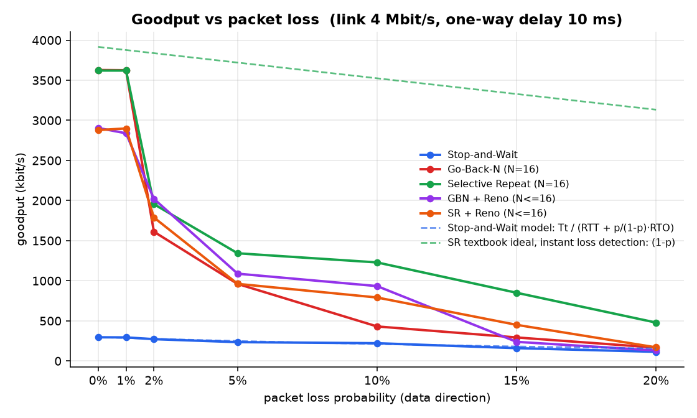
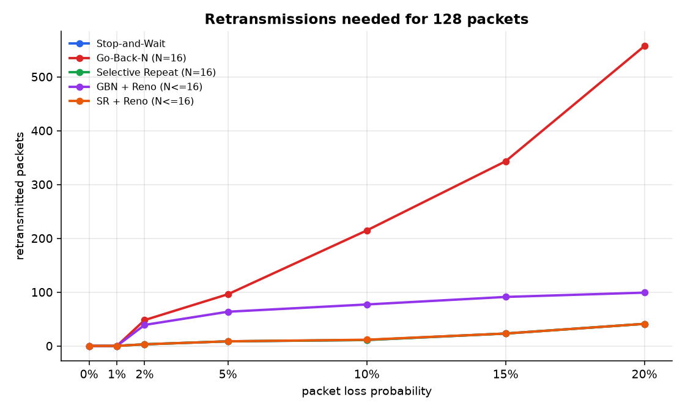
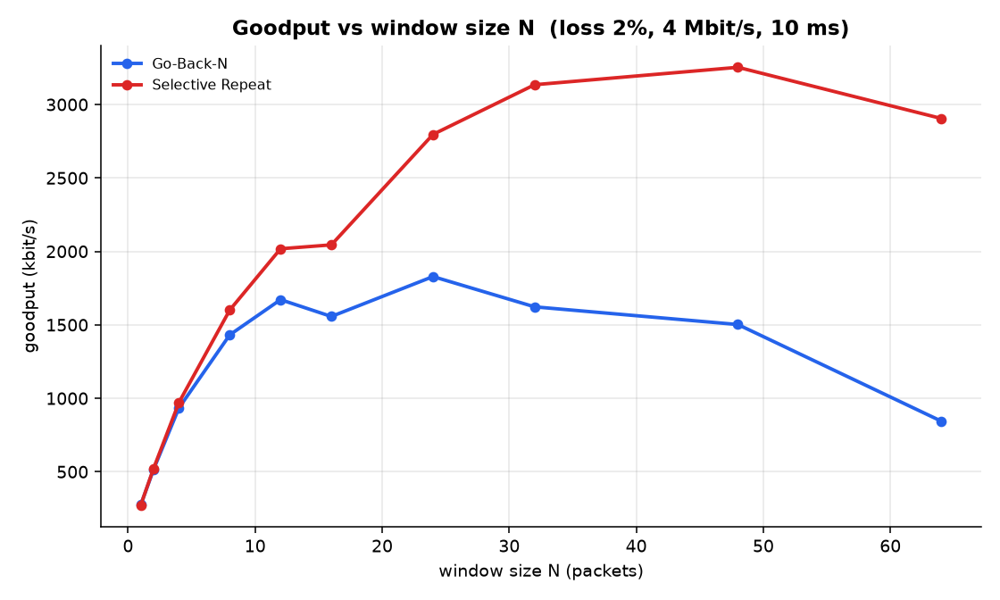
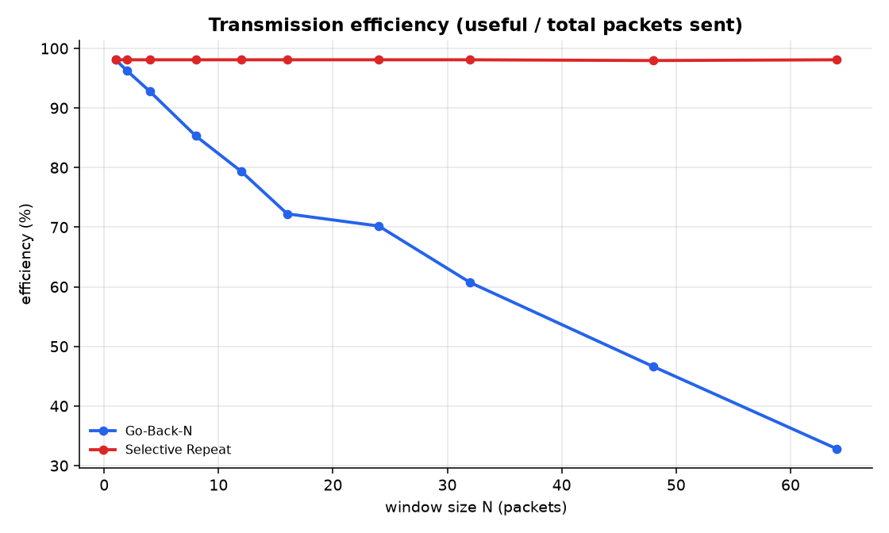
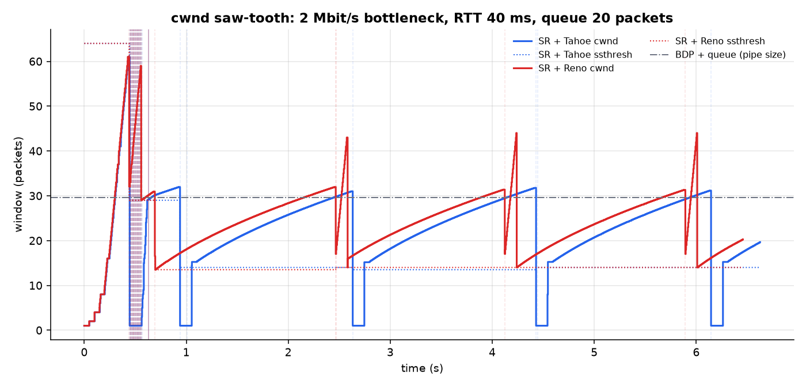
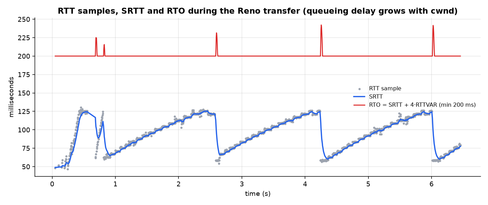
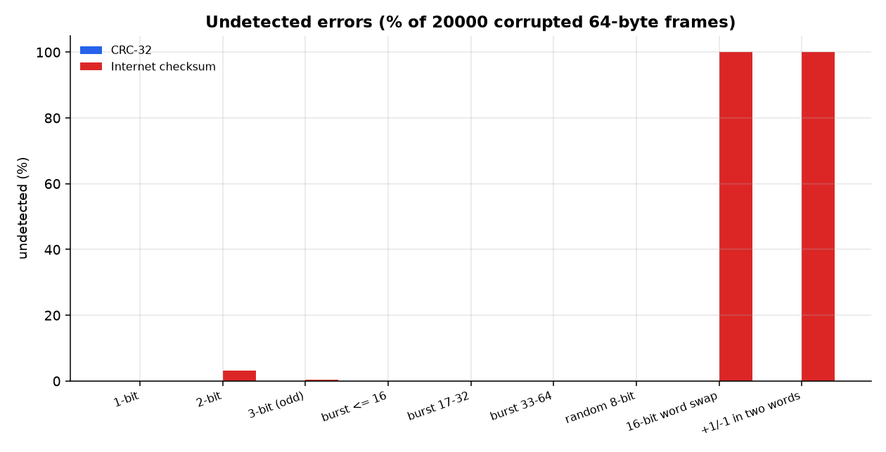
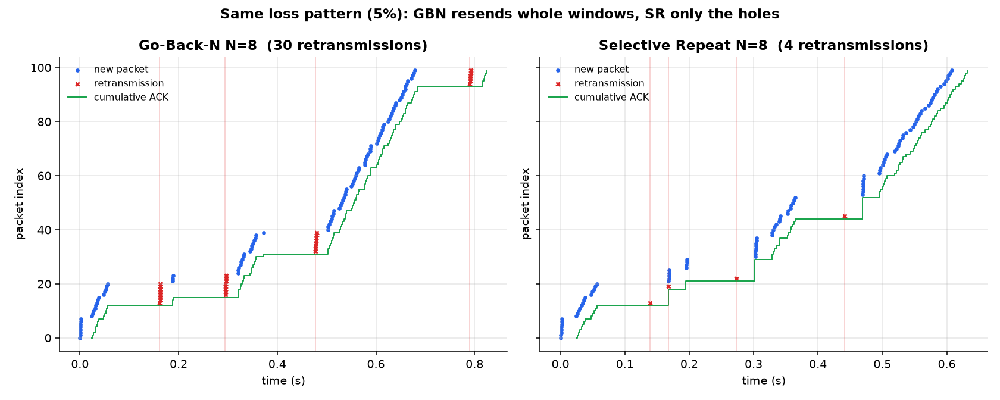

# RUDP benchmark report

Last updated 2026-11-07 16:42 by `python -m rudp bench`. All transfers are real UDP transfers over 127.0.0.1 through the link emulator; every file was checked end-to-end with SHA-256 (column `verified`). The RTO floor is 100 ms (Linux uses 200 ms for real WAN RTTs; the emulated RTT here is only 20-40 ms).

## Experiment 1 - Goodput vs packet loss
Link: 4 Mbit/s bottleneck, 10 ms one-way delay, loss applied to data packets only, 128 KB file, 2 trial(s) per point.
Measured loss-free RTT = 27.6 ms, frame transmission time Tt = 2.09 ms, so 1 + 2a = RTT/Tt = 13.2. Stop-and-Wait can therefore use at most 1/(1+2a) = 7.6% of the link; a window of N >= 13 packets is needed to fill it.

| protocol | loss | goodput_kbps | utilisation | retransmissions | timeouts | fast_retransmits | efficiency | verified |
|---|---|---|---|---|---|---|---|---|
| Stop-and-Wait | 0% | 295.3 | 7.4% | 0 | 0 | 0 | 100.0% | True |
| Stop-and-Wait | 1% | 294.0 | 7.3% | 0 | 0 | 0 | 100.0% | True |
| Stop-and-Wait | 2% | 272.1 | 6.8% | 3 | 3 | 0 | 97.7% | True |
| Stop-and-Wait | 5% | 235.0 | 5.9% | 8.5 | 8.5 | 0 | 93.8% | True |
| Stop-and-Wait | 10% | 221.4 | 5.5% | 11 | 11 | 0 | 92.2% | True |
| Stop-and-Wait | 15% | 160.1 | 4.0% | 23 | 23 | 0 | 84.8% | True |
| Stop-and-Wait | 20% | 114.3 | 2.9% | 41 | 41 | 0 | 75.8% | True |
| Go-Back-N (N=16) | 0% | 3627.4 | 90.7% | 0 | 0 | 0 | 100.0% | True |
| Go-Back-N (N=16) | 1% | 3624.8 | 90.6% | 0 | 0 | 0 | 100.0% | True |
| Go-Back-N (N=16) | 2% | 1611.4 | 40.3% | 48 | 3 | 0 | 73.3% | True |
| Go-Back-N (N=16) | 5% | 960.7 | 24.0% | 96 | 6.5 | 0 | 58.0% | True |
| Go-Back-N (N=16) | 10% | 430.6 | 10.8% | 214.5 | 16 | 0 | 38.4% | True |
| Go-Back-N (N=16) | 15% | 293.3 | 7.3% | 343 | 23 | 0 | 27.6% | True |
| Go-Back-N (N=16) | 20% | 166.6 | 4.2% | 557 | 36 | 0 | 18.7% | True |
| Selective Repeat (N=16) | 0% | 3620.9 | 90.5% | 0 | 0 | 0 | 100.0% | True |
| Selective Repeat (N=16) | 1% | 3620.4 | 90.5% | 0 | 0 | 0 | 100.0% | True |
| Selective Repeat (N=16) | 2% | 1955.2 | 48.9% | 3 | 3 | 0 | 97.7% | True |
| Selective Repeat (N=16) | 5% | 1342.7 | 33.6% | 8.5 | 7.5 | 0 | 93.8% | True |
| Selective Repeat (N=16) | 10% | 1228.7 | 30.7% | 11 | 8 | 0 | 92.2% | True |
| Selective Repeat (N=16) | 15% | 850.6 | 21.3% | 23 | 10.5 | 0 | 84.8% | True |
| Selective Repeat (N=16) | 20% | 478.8 | 12.0% | 41 | 19 | 0 | 75.8% | True |
| GBN + Reno (N<=16) | 0% | 2905.3 | 72.6% | 0 | 0 | 0 | 100.0% | True |
| GBN + Reno (N<=16) | 1% | 2838.4 | 71.0% | 0 | 0 | 0 | 100.0% | True |
| GBN + Reno (N<=16) | 2% | 2020.9 | 50.5% | 39 | 0 | 3 | 76.9% | True |
| GBN + Reno (N<=16) | 5% | 1088.4 | 27.2% | 63.5 | 2 | 6 | 67.0% | True |
| GBN + Reno (N<=16) | 10% | 933.6 | 23.3% | 77 | 1.5 | 10 | 62.6% | True |
| GBN + Reno (N<=16) | 15% | 238.6 | 6.0% | 91 | 18.5 | 5 | 59.3% | True |
| GBN + Reno (N<=16) | 20% | 130.9 | 3.3% | 99 | 36.5 | 4.5 | 56.4% | True |
| SR + Reno (N<=16) | 0% | 2878.8 | 72.0% | 0 | 0 | 0 | 100.0% | True |
| SR + Reno (N<=16) | 1% | 2899.0 | 72.5% | 0 | 0 | 0 | 100.0% | True |
| SR + Reno (N<=16) | 2% | 1788.9 | 44.7% | 3 | 0 | 3 | 97.7% | True |
| SR + Reno (N<=16) | 5% | 961.5 | 24.0% | 8.5 | 2 | 6.5 | 93.8% | True |
| SR + Reno (N<=16) | 10% | 791.4 | 19.8% | 11.5 | 4.5 | 7 | 91.9% | True |
| SR + Reno (N<=16) | 15% | 450.6 | 11.3% | 23 | 12.5 | 10 | 84.8% | True |
| SR + Reno (N<=16) | 20% | 169.8 | 4.2% | 41 | 33.5 | 7.5 | 75.8% | True |

## Experiment 2 - Sliding window size
Same link, 2% loss, 256 KB file, 3 trial(s) per point (every N uses the same link random seeds, so all points face the same loss pattern). Goodput rises roughly linearly with N until the window covers the bandwidth-delay product, then flattens at the link rate. Go-Back-N wastes more and more bandwidth as N grows because one loss forces the whole window to be resent; Selective Repeat resends only the lost packet, so its efficiency stays near (1-p).

| protocol | window | goodput_kbps | retransmissions | timeouts | efficiency | verified |
|---|---|---|---|---|---|---|
| Go-Back-N | 1 | 274.6 | 5 | 5 | 98.1% | True |
| Go-Back-N | 2 | 514.5 | 10 | 5 | 96.2% | True |
| Go-Back-N | 4 | 933.9 | 20 | 5 | 92.8% | True |
| Go-Back-N | 8 | 1431.5 | 44.333333333333336 | 5.666666666666667 | 85.3% | True |
| Go-Back-N | 12 | 1671.4 | 67.33333333333333 | 5.666666666666667 | 79.3% | True |
| Go-Back-N | 16 | 1556.9 | 101.33333333333333 | 6.333333333333333 | 72.2% | True |
| Go-Back-N | 24 | 1828.5 | 113.33333333333333 | 5 | 70.2% | True |
| Go-Back-N | 32 | 1622.4 | 171 | 6 | 60.7% | True |
| Go-Back-N | 48 | 1502.0 | 297.6666666666667 | 6.666666666666667 | 46.6% | True |
| Go-Back-N | 64 | 844.4 | 541.3333333333334 | 9.333333333333334 | 32.9% | True |
| Selective Repeat | 1 | 273.7 | 5 | 5 | 98.1% | True |
| Selective Repeat | 2 | 521.0 | 5 | 5 | 98.1% | True |
| Selective Repeat | 4 | 970.9 | 5 | 5 | 98.1% | True |
| Selective Repeat | 8 | 1600.5 | 5 | 5 | 98.1% | True |
| Selective Repeat | 12 | 2017.8 | 5 | 5 | 98.1% | True |
| Selective Repeat | 16 | 2044.4 | 5 | 5 | 98.1% | True |
| Selective Repeat | 24 | 2796.2 | 5 | 5 | 98.1% | True |
| Selective Repeat | 32 | 3134.6 | 5 | 5 | 98.1% | True |
| Selective Repeat | 48 | 3253.1 | 5.333333333333333 | 5 | 98.0% | True |
| Selective Repeat | 64 | 2904.9 | 5 | 4.333333333333333 | 98.1% | True |

## Experiment 3 - Congestion control
Bottleneck 2 Mbit/s, base RTT 40 ms, drop-tail queue of 20 packets, no random loss: every loss here is a queue overflow, i.e. congestion. Bandwidth-delay product = 9.6 packets, so the 'pipe' holds about 30 packets before the queue overflows.

* A fixed window of 128 >> pipe size floods the queue: many drops, many retransmissions, low efficiency. Go-Back-N makes it far worse (every drop resends the window) - this is congestion collapse in miniature.
* Tahoe/Reno probe for bandwidth: slow start doubles cwnd each RTT, the first overflow sets ssthresh, then congestion avoidance adds 1 packet per RTT (AIMD saw-tooth). Tahoe falls back to cwnd = 1 on every loss, Reno halves it (fast recovery).

| run | goodput_kbps | utilisation | queue_drops | retransmissions | timeouts | fast_retransmits | efficiency | verified |
|---|---|---|---|---|---|---|---|---|
| SR, no CC, N=128 | 1286.5 | 64.3% | 1804 | 1804 | 157 | 0 | 45.4% | True |
| GBN, no CC, N=128 | 495.0 | 24.8% | 7069 | 8772 | 72 | 0 | 14.6% | True |
| SR + Tahoe | 1854.5 | 92.7% | 37 | 37 | 1 | 36 | 97.6% | True |
| SR + Reno | 1902.9 | 95.1% | 35 | 36 | 1 | 35 | 97.7% | True |

## Experiment 4 - Error detection: CRC-32 vs Internet checksum
20000 random 64-byte frames per error pattern, both codes computed with the project's own implementations. CRC-32 (generator of degree 32) detects all single, double and odd-numbered bit errors and every burst of length <= 32; longer bursts slip through with probability about 2^-32. The Internet checksum is a plain sum, so it cannot see re-ordered 16-bit words or errors that cancel out in the sum.

| error_pattern | trials | crc32_undetected | inet16_undetected |
|---|---|---|---|
| 1-bit | 20000 | 0 | 0 |
| 2-bit | 20000 | 0 | 646 |
| 3-bit (odd) | 20000 | 0 | 67 |
| burst <= 16 | 20000 | 0 | 0 |
| burst 17-32 | 20000 | 0 | 0 |
| burst 33-64 | 20000 | 0 | 1 |
| random 8-bit | 20000 | 0 | 3 |
| 16-bit word swap | 20000 | 0 | 20000 |
| +1/-1 in two words | 20000 | 0 | 20000 |

## Experiment 5 - Why the window must be smaller than the sequence space
Small sequence numbers (m bits) on a link with 10% data loss and 50% ACK loss. When the window breaks the textbook limit, a retransmitted *old* packet carries the same sequence number as a *new* one the receiver is waiting for; the receiver accepts the wrong data and only the end-to-end SHA-256 check catches it ('corrupted'). 'stalled' means the sender and receiver lost agreement on the window entirely and the transfer was aborted.

| protocol | seq_bits | seq_space | window | rule | correct | corrupted | stalled |
|---|---|---|---|---|---|---|---|
| GBN | 2 | 4 | 3 | safe: N = 2^m - 1 | 6 | 0 | 0 |
| GBN | 2 | 4 | 4 | UNSAFE: N = 2^m | 2 | 0 | 4 |
| SR | 3 | 8 | 4 | safe: N = 2^(m-1) | 6 | 0 | 0 |
| SR | 3 | 8 | 5 | UNSAFE: N > 2^(m-1) | 1 | 5 | 0 |
| SR | 3 | 8 | 6 | UNSAFE: N > 2^(m-1) | 0 | 6 | 0 |

## Experiment 6 - Sequence / time diagram
Blue dots: first transmissions. Red crosses: retransmissions. Green: cumulative ACK. Vertical red lines: timeouts. Both runs use the same random seed for the link.

